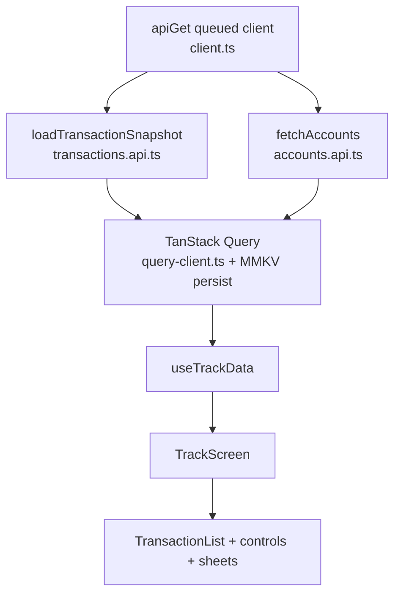

# Architecture

Design notes for the Track screen, tied to the modules that implement them.

## Cursor pagination

Implemented in [`src/features/transactions/api/transactions.api.ts`](../src/features/transactions/api/transactions.api.ts).

- Page size is `TRANSACTION_PAGE_LIMIT` (**50**).
- `fetchAllTransactionsWithToken` walks `next_cursor` until it is null.
- Overlapping rows across pages are skipped by **transaction id** (`seenIds`).
- A cursor that appears twice fails the sync with `ApiError` (`Transaction pagination returned a cursor that was already used.`). The same guard applies when paging the changes feed.

## Full sync, then changes feed, and 410 recovery

Same module: `loadTransactionSnapshot`.

1. **Cold / no token:** page the full list, keep `sync_token`, then request `/v1/transactions/changes?since=<token>`. Merge with [`apply-transaction-changes.ts`](../src/features/transactions/utils/apply-transaction-changes.ts). If changes fail, keep the full list, set `changesSynced: false`, and surface `changesErrorMessage` (or a default notice in the UI).
2. **Warm / cached token:** request changes only. On success, merge and update the token.
3. **HTTP 410** on changes: treat the token as expired, run **one** full list resync, then try changes again with the new token. There is no 410 retry loop. If the full list itself fails after a 410, the error propagates and the previous snapshot stays in the Query cache until a successful load.

Merge rules in `applyTransactionChanges`: a change applies only when `updated_at` is strictly newer than the stored row; newer `deleted: true` removes the id; new ids insert newest-first by occurred time.

## Normalization and IST

[`normalize-transaction.ts`](../src/features/transactions/utils/normalize-transaction.ts) accepts:

- **Canonical** rows (`occurred_at`, `amount_minor`, …)
- **Legacy** rows (`txn_time`, major-unit `amount` string, …)

Invalid rows become normalization failures (id + reason) and stay out of totals / list rows.

IST calendar handling lives in [`month-totals.ts`](../src/features/transactions/utils/month-totals.ts):

- Offset **+5:30** (`IST_OFFSET_MS`) applied to UTC timestamps
- `indiaMonthKey` / `indiaDateParts` drive month chips, list dates, and detail timestamps via [`track-month.ts`](../src/features/transactions/utils/track-month.ts)

## Self-transfer / own-account exclusion

`isOwnAccountTransfer` in `month-totals.ts`:

- `counterparty.type === 'OWN_ACCOUNT'`, or
- legacy `linkedAccountLast4` present

Those rows still appear in the list and detail sheet (with a self-transfer note). They are **excluded** from income and spend in `sumMonthMinor` / `formatMonthTotals`.

## Integer minor-unit money

- API and normalized model keep amounts as **integer minor units** (no float totals).
- `formatMinorDecimal` / `formatTransactionAmount` in [`format-amount.ts`](../src/features/transactions/utils/format-amount.ts) and `month-totals.ts` split with integer arithmetic and preserve a leading `-` for negatives (for example `-105` → `-1.05`).
- INR / null currency: primary uses Indian grouping with `₹`. USD uses `$` plus optional `₹` secondary from `inrAmountMinor`. Other codes show `CODE` + western grouping.
- Month cards and amount sort use the same rupee rule: INR/null → `amountMinor`; otherwise `inrAmountMinor` when present ([`track-list.ts`](../src/features/transactions/utils/track-list.ts) `rupeeMinor`).

## Data flow

### API client

[`src/lib/api/client.ts`](../src/lib/api/client.ts):

- Axios instance, `baseURL` from `EXPO_PUBLIC_API_URL`, 15s timeout
- All Track GETs go through `apiGet` → **one-at-a-time queue** (`enqueue`)
- Retries only for status **429 / 500 / 503**, up to `API_RETRY_ATTEMPTS` (4 attempts). Delays: `2000 * 2^attempt` ms (2s, 4s, 8s…), or longer if `Retry-After` asks for more
- Network errors and other statuses (including **410**) are not retried by the client

### TanStack Query

[`src/lib/query/query-client.ts`](../src/lib/query/query-client.ts) and [`src/app/_layout.tsx`](../src/app/_layout.tsx):

- Default `staleTime` 60s, `gcTime` / persist `maxAge` **24 hours** (`QUERY_PERSIST_MAX_AGE_MS`)
- `retry: false` at the Query layer (HTTP retries stay in `apiGet`)
- `PersistQueryClientProvider` with MMKV sync persister
- Persist `onError`: log, then `queryPersister.removeClient()` so a corrupt cache does not block a fresh fetch

`useTransactions` passes the cached snapshot into `loadTransactionSnapshot` so refreshes prefer the changes feed.

### `useTrackData` → UI

[`use-track-data.ts`](../src/features/transactions/hooks/use-track-data.ts) composes `useAccounts` + `useTransactions`, normalizes, builds the month view, and applies list criteria.

[`track-screen.tsx`](../src/features/transactions/components/track-screen.tsx) wires month selector, summary cards, filters, list, and detail sheet.

`useMonthlySummary` / `summary.api.ts` remain in the codebase and are tested, but **Track cards do not call them**; they use IST totals from the synced month set.

## `useTrackData` list updates

- Month, category, direction, and sort changes apply **immediately** (pending search debounce cleared first).
- Search text alone is debounced **200 ms** (`LIST_UPDATE_DELAY_MS`).
- Every effect path returns the same `clearDebounce` cleanup so a pending timer cannot overwrite a newer instant filter after unmount or after a non-query change.

## List performance

[`transaction-list.tsx`](../src/features/transactions/components/transaction-list.tsx):

- `TransactionRow` wrapped in `memo`
- Module-level stable `keyExtractor` (by `id`)
- `renderItem` via `useCallback`
- FlatList: `initialNumToRender={15}`, `maxToRenderPerBatch={10}`, `windowSize={11}`, `removeClippedSubviews` enabled off-web
- **No `getItemLayout`**: row height varies (merchant wrap, optional secondary amount / status), so fixed offsets would be wrong

Shared sheets use [`bottom-sheet.tsx`](../src/features/transactions/components/bottom-sheet.tsx): Modal slide, title / selection / header beside an **×** close control, backdrop dismiss, scroll overflow hint. There is no drag-to-close gesture.
